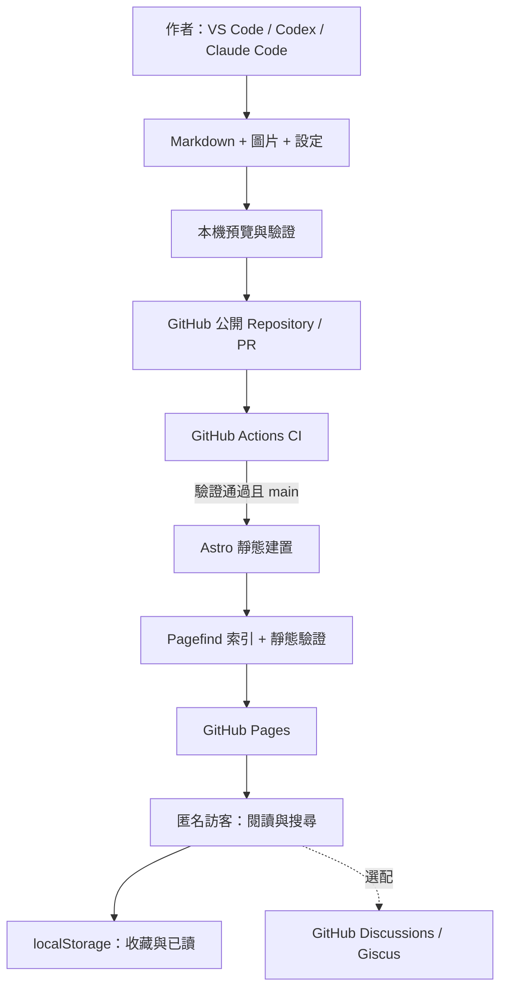

# LearningHub｜GitHub-Native 個人學習知識庫

> **待實作開發規格書 v1.0** · 2026-11-17 · 繁體中文  
> 狀態：方案 E 已確認，尚未實作與部署。  
> 目標讀者：產品負責人、開發者、Codex、Claude Code。  
> 建議 Repository：`learning-hub`（公開）；正式環境：GitHub Pages。

## 0. 文件導覽

- [1. 產品定位](#1-產品定位)
- [2. 範圍與優先級](#2-範圍與優先級)
- [3. 技術架構](#3-技術架構)
- [4. 資訊架構與路由](#4-資訊架構與路由)
- [5. UIUX 設計](#5-uiux-設計)
- [6. 元件與功能契約](#6-元件與功能契約)
- [7. 內容資料模型](#7-內容資料模型)
- [8. Markdown 寫作與發布](#8-markdown-寫作與發布)
- [9. 搜尋、關聯與排序](#9-搜尋關聯與排序)
- [10. 本機閱讀資料](#10-本機閱讀資料)
- [11. 專案結構與開發環境](#11-專案結構與開發環境)
- [12. GitHub CI/CD](#12-github-cicd)
- [13. 安全、隱私及授權](#13-安全隱私及授權)
- [14. 效能、SEO 與可及性](#14-效能seo-與可及性)
- [15. 開發階段與工作清單](#15-開發階段與工作清單)
- [16. 測試及驗收](#16-測試及驗收)
- [17. 營運與維護](#17-營運與維護)
- [18. AI 開發交付規範](#18-ai-開發交付規範)
- [19. 待確認事項與參考來源](#19-待確認事項與參考來源)

---

## 1. 產品定位

### 1.1 願景

建立可持續累積個人學習成果並公開分享的知識入口網站。以 Markdown 作為文章唯一正式來源，以 GitHub 作為內容版本控制、協作及網站託管平台。參考使用者提供的卡片式介面：左側分類及階層目錄、頂部分類切換、最新文章區、三欄圖文卡片、已讀標記與熱門區；轉化為具備技術文件閱讀能力的自有品牌，不複製來源網站的文字、圖像及商標。

### 1.2 整合方案 E

| 原方案 | 吸收優點 | 實作決策 |
|---|---|---|
| Astro | 靜態生成、內容集合、SEO、少量 JS | 核心框架 |
| VitePress | 文件側欄、章節 TOC、Markdown 閱讀 | 自建文件式閱讀布局 |
| Nuxt | Vue 生態、元件化、可擴充 UI | Vue 3 islands 與共用 composables |
| Next.js | 路由、內容最佳化、功能模組邊界 | 借鑑設計，不安裝 Next.js |

**非目標**：同時安裝四套框架、架設常駐 API、資料庫、Docker 或自行建置會員系統。公開訪客無需帳號即可閱讀。核心服務不依賴外部 SaaS。

### 1.3 角色與情境

| 角色 | 主要權限／流程 |
|---|---|
| 作者／維護者 | 本機撰寫、預覽、驗證、Git 提交、審核與發布 |
| 一般訪客 | 閱讀、搜尋、分類探索、分享、瀏覽器本機收藏 |
| GitHub 社群使用者 | 選配留言、Issue、Fork/PR 勘誤；不能直接發布 |
| CI 機器人 | 檢查內容、建置與部署；僅授予必要權限 |

成功標準：作者新增一篇合規 Markdown 後，不需改 UI 或手動重建索引；網站自動出現文章、分類統計、搜尋結果、RSS 與相關內容。訪客可直接刷新文章 URL、匿名閱讀並於手機使用。

## 2. 範圍與優先級

P0 = 首次公開上線必備；P1 = 第二階段；P2 = 進階可選。所有階段規格均列入本文件，不代表全部在 MVP 完成。

| ID | 功能 | 優先 |
|---|---|---|
| F01 | 首頁、最新、精選、作者推薦、卡片／清單 | P0 |
| F02 | 主分類、子分類、統計、類型、標籤、分頁 | P0 |
| F03 | Markdown、文章頁、TOC、程式碼、表格、圖片、公式、流程圖 | P0 |
| F04 | Pagefind 全文搜尋、中英文、篩選與鍵盤操作 | P0 |
| F05 | RWD、Light/Dark/System、404、無障礙 | P0 |
| F06 | SEO、RSS、Sitemap、社群分享資料 | P0 |
| F07 | GitHub Actions、Pages、內容驗證、安全掃描 | P0 |
| F08 | 收藏、已讀、閱讀歷史、個人閱讀中心 | P1 |
| F09 | 學習路徑、順序、進度、相關文章 | P1 |
| F10 | 資源收藏庫、附件、Markdown 下載 | P1 |
| F11 | GitHub Discussions/Giscus、Issue 勘誤 | P2 |
| F12 | 知識關聯圖、知識統計 | P2 |
| F13 | 瀏覽器端工具實驗室、互動圖表 | P2 |
| F14 | 內容模板 CLI、連結檢查、AI 輔助整理 | P2（基礎驗證 P0） |

真正的跨使用者熱門排行、跨裝置同步、後台線上編輯及會員登入不屬於純 GitHub Pages MVP。未接分析服務時標示「作者推薦」，不可冒用真實流量數據。

## 3. 技術架構

### 3.1 選型與邊界

| 層 | 技術與責任 |
|---|---|
| 靜態網站 | Astro，`output: 'static'`，建置期生成所有頁面 |
| 內容 | Content Collections（glob/file loader），Zod schema，Markdown 優先 |
| 互動 | Vue 3 + TypeScript；搜尋、收藏、篩選、關聯圖等選擇性 hydration |
| 樣式 | Tailwind CSS、CSS variables、Lucide（按需匯入） |
| Markdown | Astro Markdown/Shiki；GFM、remark-math/rehype-katex、受控 Mermaid 渲染；MDX 選配 |
| 搜尋 | npm Pagefind Extended，建置完成後索引 dist |
| 儲存 | Git 內容、靜態 JSON、瀏覽器 localStorage |
| 測試 | Vitest、Playwright、axe、靜態連結與內容檢查 |
| 交付 | npm lockfile、GitHub Actions、GitHub Pages |

版本策略：以實作當日官方支援版本為準。預設 Node 24 LTS（先核對所選 Astro、Vue、Vite 與 Windows 10 相容性），CI 與本機共用 `.nvmrc`/`engines`；提交 package-lock.json。Tailwind 使用所選版本的官方 Astro/Vite 整合，不混用不同 major 的設定。禁止盲目升級。Windows 無法執行時，可用 Ubuntu Remote SSH 進行開發，正式環境依然是 GitHub Pages。

### 3.2 系統資料流



建置期：載入、驗證、過濾已發布文章、建立索引與聚合資訊、輸出 HTML/CSS/JS。運行期：瀏覽器讀取靜態頁面及必要索引；不執行 Node、Python 或資料庫查詢。Vue 只負責局部互動，不將整站退化成 SPA。

### 3.3 站點設定與 base path

Repository project site 預設為 `https://<username>.github.io/learning-hub/`；使用者站或自訂網域的 base 可為 `/`。不得硬編碼帳號、Repo 名稱或 `localhost`。集中設定 `SITE_URL`（origin）與 `SITE_BASE`（路徑）。範例（尚未執行）：

```js
// astro.config.mjs
import { defineConfig } from 'astro/config';
import vue from '@astrojs/vue';
import sitemap from '@astrojs/sitemap';

export default defineConfig({
  site: process.env.SITE_URL || 'https://example.github.io',
  base: (process.env.SITE_BASE ?? '/learning-hub') || '/',
  output: 'static',
  trailingSlash: 'always',
  integrations: [vue(), sitemap()],
  markdown: { syntaxHighlight: 'shiki' },
});
```

所有站內 URL、圖片、manifest、RSS、Sitemap、Pagefind 路徑與 downloads 透過統一 URL helper。`withBase('/articles/foo/')` → `/learning-hub/articles/foo/`；base `/` 時 → `/articles/foo/`。外部絕對 URL、fragment 不加 prefix；禁止雙重 prefix、`..` 越界與不安全 URL。Pagefind UI 的 bundle path 及搜尋結果 URL 必須分別測試，避免 prefix 遺漏或重複。正文相對圖片使用 Astro 資產處理；引用 public 資源須使用 base-aware 轉換。正式 CI 檢查無占位 origin。

## 4. 資訊架構與路由

| 路徑（以下不含 base） | 功能 | 階段 |
|---|---|---|
| `/` | 首頁、最新、精選、分類統計 | P0 |
| `/articles/`、`/articles/page/2/` | 所有文章與靜態分頁 | P0 |
| `/articles/[...slug]/` | 文章詳情 | P0 |
| `/categories/`、`/categories/[category]/` | 分類總覽、主分類 | P0 |
| `/categories/[category]/[subcategory]/` | 子分類 | P0 |
| `/tags/`、`/tags/[tag]/` | 標籤總覽／詳情 | P0 |
| `/types/[type]/` | 內容類型 | P0 |
| `/search/` | 搜尋頁，`?q=`可分享 | P0 |
| `/about/` | 作者、理念、授權、聯絡入口 | P0 |
| `/rss.xml`、`/sitemap-index.xml` | RSS、Sitemap（以實際產物為準） | P0 |
| `/404.html` | 找不到頁面、回首頁、搜尋 | P0 |
| `/paths/`、`/paths/[slug]/` | 學習路徑 | P1 |
| `/library/` | 收藏、已讀、近期閱讀 | P1 |
| `/resources/` | 資源庫 | P1 |
| `/graph/` | 關聯圖 | P2 |
| `/tools/`、`/tools/[slug]/` | 工具實驗室 | P2 |

列表預設 12 筆／頁。大型分類同樣產生 `/page/[n]/`（不可只有首頁有分頁）；實作時中央路由 helper 生成連結，避免重複 route。未啟用的功能不出現在導航。slug 使用英文小寫、數字、連字號，可有明確層級；公開後不可任意修改。舊 slug 以靜態轉址頁或相容頁處理，不依賴伺服器 301；更新內部連結。

### 4.1 預設分類（可配置）

| ID | 名稱 | 子分類範例 |
|---|---|---|
| ai | AI 與人工智慧 | agent、mcp、llm、rag、skills、prompt |
| development | 程式開發 | vue、react、python、typescript、api |
| infrastructure | 系統與基礎架構 | linux、docker、windows、network、git |
| data | 資料庫與數據分析 | sql、postgresql、sqlite、visualization |
| opensource | 開源專案研究 | evaluation、integration、review |
| healthcare-it | 醫療資訊技術 | integration、iot、equipment |
| design | UI/UX 與產品設計 | dashboard、prototype、specification |
| experience | 學習心得與實作經驗 | troubleshooting、automation、practice |

內容類型獨立：tutorial（教學）、note（筆記）、review（評估）、project（實作）、resource（資源）、reference（參考）、reflection（心得）。同一文章只選一主分類、一可選子分類、多標籤；不得為了多入口複製內容。分類 ID 由設定檔管理，名稱及排序可調整。

## 5. UIUX 設計

### 5.1 設計原則與 Token

參考附件主要資訊密度與結構，但採用原創內容與視覺。桌面優先的資訊入口兼顧手機，卡片封面以 16:9 為基準，留白適中，主次層級明確；避免大型空泛 Hero 壓縮首屏內容。

| Token | Light | Dark |
|---|---|---|
| background | #F6F7F2 | #151913 |
| surface | #FFFFFF | #20251E |
| text | #242C21 | #EFF3E8 |
| muted | #586451 | #ADB9A6 |
| primary | #B9ED3E | #B9ED3E |
| on-primary | #242C21 | #242C21 |
| accent | #F7CA72 | #F7CA72 |
| border | #DBE1D5 | #414B3C |

主色不得直接作淺底細字；連結需足夠對比。以 WCAG AA 實測為準。字體：系統優先 `Noto Sans TC`, `Microsoft JhengHei`, sans-serif；程式碼使用系統等寬字體。避免強制下載大型字型。間距 4/8/12/16/24/32/48px；卡片 radius 14px；正文 16–18px、line-height 1.75，閱讀區寬約 760–840px。

| viewport | 布局 |
|---|---|
| ≥1280px | 左欄 248px＋主區三欄卡片；文章左右雙側欄 |
| 1024–1279px | 左欄 220px＋兩欄；文章右 TOC 可收合 |
| 768–1023px | 左欄抽屜、兩欄卡片；文章 TOC 可展開 |
| <768px | 一欄卡片、抽屜導覽、黏性頂欄與搜尋入口 |

### 5.2 首頁線框

```text
┌─────────────────────────────────────────────────────────────────────────┐
│ LearningHub  首頁  學習路徑  資源庫  關於       搜尋⌘K  GitHub  主題 │
├─────────────────┬───────────────────────────────────────────────────────┤
│ 知識分類        │ 最新更新  全部  教學  筆記  評估  實作   [列表/卡片] │
│ 全部內容    128 │ 最新學習筆記   共 N 篇     排序：最近更新 ▼          │
│ AI           32 │                                                       │
│ 程式開發     21 │ ┌─────────────┐ ┌─────────────┐ ┌─────────────┐      │
│ 系統架構     18 │ │  封面 16:9  │ │  封面 16:9  │ │  封面 16:9  │      │
│ ...             │ │分類 TYPE NEW│ │分類 TYPE    │ │分類 TYPE 已讀│     │
│ ─────────────── │ │標題         │ │標題         │ │標題          │     │
│ 階層目錄        │ │摘要 2–3 行  │ │摘要 2–3 行  │ │摘要 2–3 行   │     │
│ ▸ AI / MCP      │ │日期 · 8 min │ │日期 · 5 min │ │日期 · 12 min │     │
│ ▸ Docker        │ └─────────────┘ └─────────────┘ └─────────────┘      │
│ ─────────────── │ ...                 [上一頁] 1 2 3 [下一頁]          │
│ 作者推薦        │                                                       │
└─────────────────┴───────────────────────────────────────────────────────┘
```

數字為示意，正式資料由發布內容計算。左側支援展開、折疊、目前分類高亮及 aria-current；頂部類型篩選可使用 URL 查詢參數（不影響基礎靜態入口）。新文章徽章以發布日距離建置日 ≤14 天（Asia/Taipei）計算；更新文章另標示 UPDATED；下次建置刷新，不宣稱即時。首頁最新排序預設更新日降序。卡片含封面、分類、類型、標題、摘要、日期、閱讀時間；收藏按鈕獨立，不嵌套在主連結。無封面採本地分類預設圖，禁止外部隨機圖片 API。

### 5.3 文章閱讀頁線框

```text
┌────────────────────────────────────────────────────────────────────────┐
│ Logo / 主導航 / 搜尋 / 主題                                            │
├───────────────┬─────────────────────────────────────┬──────────────────┤
│ 同分類文件    │ 首頁 > AI > MCP                     │ 本篇文章目錄     │
│ ▸ 基礎概念    │ MCP 架構與實作完整指南              │ 1. 基礎概念      │
│ ● MCP 入門    │ 日期 · 初階 · 12 分鐘 · 標籤        │ 2. 環境準備      │
│ ▸ 實作教學    │ ──閱讀進度──                        │ 3. 實作          │
│               │ ## 基礎概念                         │ 4. 參考資料      │
│               │ 正文、圖表、提示框                  │ ──────────────── │
│               │ ┌程式碼──────────────[複製]┐        │ 收藏 / 已讀      │
│               │ └──────────────────────────┘        │ 分享 / 原始檔    │
│               │ 上一篇 / 下一篇 / 相關文章          │ 回報問題         │
└───────────────┴─────────────────────────────────────┴──────────────────┘
```

TOC 從 H2/H3 生成、相同標題產生唯一 anchor，IntersectionObserver 高亮；長文提供回頂部。程式碼可橫向捲動、複製成功／失敗提示。表格外層可捲動；圖片 alt、可選放大、Esc 關閉及焦點還原。影片以明確播放／外部連結方式提供，不自動播放。文章 H1 唯一、正文從 H2 開始。上／下一篇優先系列順序，其次同分類排序。

### 5.4 其他畫面與狀態

- 搜尋：全站快捷鍵 Ctrl/Cmd+K 打開；Esc 關閉；可跳轉完整搜尋頁。輸入、載入中、零結果、索引故障、重試均需呈現。
- 學習路徑：路徑卡片含名稱、程度、章節數、進度；章節按設定順序展示，前往下一章。
- 資源庫：依工具類型與標籤篩選，資源卡片顯示來源、授權（未知則未知）、維護者評語、最後查核日；不虛構 stars 或版本。
- 閱讀中心：收藏、已讀、最近瀏覽，提供移除、清空確認與本機資料匯出／匯入。
- 404：友善文案、回首頁及搜尋，不能以 SPA fallback 取代真正靜態路由。
- 主題：Light/Dark/System，首次依系統，後續保存；避免首屏閃白。動畫遵守 prefers-reduced-motion。

## 6. 元件與功能契約

| 元件 | 技術 | 輸入 | 行為／輸出 |
|---|---|---|---|
| BaseLayout | Astro | title, description, canonical, image | SEO、全域 Header/Footer、主題初始化 |
| SiteHeader | Astro + Vue island | nav, base, searchEnabled | 導航、搜尋開關、主題事件 |
| CategorySidebar | Astro / Vue | categoryTree, counts, active | 展開、active、mobile drawer |
| ArticleCard | Astro | ArticleSummary | 靜態可索引連結、封面、meta |
| CardStatus | Vue | stableId | 收藏、已讀；本機狀態 |
| ArticleGrid | Astro | items, pagination | 空狀態、卡片／列表可切換 |
| FilterBar | Vue | availableTypes, selected | 更新 URL、回第一頁；提供靜態分類連結 fallback |
| ArticleLayout | Astro | article, headings, neighbors | 文章、TOC、相關、導覽 |
| TocNav | Astro + JS | headings | anchor、scroll spy |
| CodeCopy | JS | code block target | Clipboard 或選取文字 fallback |
| SearchDialog / Page | Vue | initialQuery, filters, base | lazy load Pagefind、取消過期回應、鍵盤操作 |
| ThemeToggle | Vue / JS | initialPreference | light/dark/system |
| ReaderActions | Vue | stableId, canonical | 收藏、已讀、分享、下載 |
| LearningPath | Astro + Vue | path, chapters | 顯示步驟、已讀進度 |
| ResourceCard | Astro | Resource | 外部連結、來源及查核日期 |
| KnowledgeGraph | Vue (lazy) | graph JSON | 節點互動、縮放、列表替代 |
| ToolHost | Vue (lazy) | tool registry entry | 受控本機工具，無任意程式執行 |
| CommentSection | Vue / Astro | enabled, stableId | 同意後載入 Giscus；停用時不載入 |

元件原則：展示型使用 Astro；事件／狀態使用 Vue；首屏必要互動 `client:load`，低優先使用 `client:visible`/`client:idle`。不要為每張卡片建立完整 Vue App；收藏狀態可使用單一 island 或輕量事件委派。共享狀態以 composable + 自訂事件或單一 island 實作，跨 island 不假設 Vue provide/inject 可通用。

### 6.1 靜態資料接口

```ts
interface ArticleSummary {
  stableId: string; slug: string; title: string; description: string;
  category: string; subcategory?: string; type: string; tags: string[];
  publishedAt: string; updatedAt?: string; readingMinutes: number;
  coverUrl: string; url: string; difficulty?: string; featured: boolean;
}
interface CategoryNode {
  id: string; label: string; count: number; url: string;
  children: Array<{ id: string; label: string; count: number; url: string }>;
}
```

P0 優先靜態 HTML 與 Pagefind，不下發整站正文 JSON。需要互動篩選時生成輕量 `data/articles-index.json`、`data/categories.json`；可選 P2 `data/graph.json`。只使用公開欄位，含 schemaVersion、generatedAt，無草稿及未發布內容。JSON 大小需驗收，超過效能預算時改按分類切片。搜尋索引按需載入，不同查詢不重複初始化。

## 7. 內容資料模型

### 7.1 Article frontmatter

| 欄位 | 型別 | 規則 |
|---|---|---|
| stableId | string | 必填、全域唯一、不可變；與 Astro loader entry.id 分開 |
| slug | string | 必填、全域唯一、可含斜線、不可含空格／URL 特殊字元 |
| title | string | 必填 1–120 字 |
| description | string | 必填 1–240 字 |
| category | string | 必填，存在 taxonomy |
| subcategory | string? | 必須屬於主分類 |
| type | enum | 7 種內容類型之一 |
| tags | string[] | 0–12 個，使用已正規化 tag ID，不重複 |
| publishedAt | YYYY-MM-DD | 必填、有效日期，Asia/Taipei 日期語意 |
| updatedAt | YYYY-MM-DD? | 不早於 publishedAt |
| cover | local path? | 建議正文同目錄相對路徑，如 `./cover.webp` |
| coverAlt | string? | 自訂封面需 alt（裝飾圖可空字串並明確標記） |
| difficulty | enum? | beginner/intermediate/advanced |
| featured | boolean | 預設 false |
| featuredOrder | int? | 精選排序，數字小在前 |
| draft | boolean | 必填，作者模板預設 true；公開前改 false |
| related | string[] | 其他文章 stableId，不能自指 |
| aliases | string[] | 舊 slug，不可與正式路徑衝突 |
| sourceLinks | array? | `{ title, url }`，http(s) 網址 |
| license | string? | 預設站點內容授權 |

`stableId` 例 `ai-mcp-001`；不把 loader entry.id 當閱讀紀錄 ID。既有提案的 `id` 欄位在正式模型統一命名 `stableId`，避免混淆。`slug` 仍是公開路徑，需集中验证；修改 slug 不會遺失本機收藏。

### 7.2 其他集合

| 集合 | 必填欄位與規則 |
|---|---|
| taxonomy | categories[{id,label,order,icon,children[]}], tags[{id,label,aliases[]}], types[]；ID 唯一、禁止循環 |
| learningPaths | id, slug, title, description, difficulty, steps[{articleId, title?}], draft；步驟不重複、參照已發布文章 |
| resources | id, title, url, description, type, tags, checkedAt, draft；可選 license, notes, category |
| tools | id, slug, title, description, componentKey, enabled；僅允許靜態白名單中的元件 |

分類、標籤設定放 JSON/YAML。文章／路徑／資源使用 `.md` 與 frontmatter。工具登錄採程式碼白名單而非 Markdown 任意腳本。所有參照、日期、別名、slug 衝突必須在建置前檢查。正式資料只允許 `draft=false` 且發布日不晚於建置日（更新日期不得在未來）。未發布資料不可進入任何公開輸出。未公開內容不得提交公共 repo，即使 draft=true。

### 7.3 Astro schema 參考實作

```ts
// src/content.config.ts（節錄，需補齊跨資料檢查）
import { defineCollection } from 'astro:content';
import { glob } from 'astro/loaders';
import { z } from 'astro/zod';
const slug = z.string().regex(/^[a-z0-9]+(?:-[a-z0-9]+)*(?:\/[a-z0-9]+(?:-[a-z0-9]+)*)*$/);
const date = z.string().regex(/^\d{4}-\d{2}-\d{2}$/);
const article = defineCollection({
  loader: glob({ base: './src/content/articles', pattern: '**/*.{md,mdx}' }),
  schema: ({ image }) => z.object({
    stableId: z.string().regex(/^[a-z0-9][a-z0-9-]*$/),
    slug, title: z.string().min(1).max(120),
    description: z.string().min(1).max(240),
    category: z.string().min(1), subcategory: z.string().optional(),
    type: z.enum(['tutorial','note','review','project','resource','reference','reflection']),
    tags: z.array(z.string()).max(12).default([]),
    publishedAt: date, updatedAt: date.optional(),
    cover: image().optional(), coverAlt: z.string().optional(),
    difficulty: z.enum(['beginner','intermediate','advanced']).optional(),
    featured: z.boolean().default(false), featuredOrder: z.number().int().nonnegative().optional(),
    draft: z.boolean(), related: z.array(z.string()).default([]),
    aliases: z.array(slug).default([]),
    sourceLinks: z.array(z.object({ title: z.string(), url: z.string().url() })).default([]),
    license: z.string().optional(),
  })
});
export const collections = { articles: article };
```

日期示例請使用引號，另外驗證實際年月日、不允許 2026-02-30、時區及排序。`sourceLinks` 另檢查 protocol。`getPublishedArticles()` 作為所有公開頁面單一入口。跨集合一致性另由 `validate-content` 處理；此節錄未包含所有集合、整合或測試。

## 8. Markdown 寫作與發布

### 8.1 標準文章範本

```markdown
---
stableId: 'ai-mcp-001'
slug: 'mcp-introduction'
title: 'MCP 架構與實作完整指南'
description: '從基礎概念到 MCP Server 實作的學習紀錄。'
category: 'ai'
subcategory: 'mcp'
type: 'tutorial'
tags: ['mcp', 'ai-agent', 'python']
publishedAt: '2026-11-17'
updatedAt: '2026-11-17'
cover: './cover.webp'
coverAlt: 'MCP 架構示意圖'
difficulty: 'beginner'
featured: true
draft: false
related: []
---

## 學習目的

## 環境與版本

## 核心概念

## 實作步驟

## 測試結果與問題排除

## 學習心得

## 參考資料
```

目錄例 `src/content/articles/ai/mcp-introduction/index.md` 與 `cover.webp` 同層；無封面時移除 cover 欄位。草稿範本存於 `docs/templates/`，不被 loader 掃描。`npm run new:article -- --category ai --slug mcp-introduction`（待實作）互動或參數式建立模板，預設 draft=true 且輸出到私人工作區；公開時才複製進 repo。

### 8.2 語法與渲染

支援 CommonMark/GFM、表格、任務清單、引用、腳註（確認選用 parser）、Shiki、Mermaid、KaTeX、提示框與圖片說明。Mermaid 使用受限配置 `securityLevel: 'strict'`，不接受任意 HTML 或腳本；延遲載入，失敗顯示原始碼。KaTeX trust=false。提示框採受控 directive，如 `:::tip`（需實作 parser），不直接執行任意 HTML。MDX 僅允許受信任作者和白名單元件，PR 不可直接部署。Markdown 外部連結僅 http/https/mailto（依情境白名單），外開加 rel 安全屬性。

Markdown 下載提供本身公開原始筆記的靜態副本，附件獨立連結；相對圖片不保證單獨下載後可離線顯示，需提示，P1 可新增文章包（md+assets，受大小限制）。GitHub 原始碼連結指向實際檔案及 main 或 commit，不把其他專案路徑當 URL。文章可透過 GitHub edit/issue 發起勘誤。

### 8.3 發布流程

1. 私人 workspace 撰寫、移除機密與不必要資訊；本機預覽可用非公開資料，但不要提交。
2. 明確審查著作權、資料保密、附件 EXIF 等；複製核准稿到公共 repo；生成封面或使用原創圖。
3. 執行 `npm run validate:content`、`npm run check`、`npm test`、`npm run build`；檢查搜尋與靜態頁面。
4. 建立分支、commit、push、PR。公共 PR 本身可被看見，審查不可延後到 PR 才做。
5. CI 通過後合併 main，自動發布並驗證 URL。
6. 修正以 commit 保留版本，更新 updatedAt；撤下公開頁須同步清除索引、RSS、舊副本。Git 歷史仍可能存在。

## 9. 搜尋、關聯與排序

### 9.1 搜尋契約

`npm run build` 執行 Astro 後再執行 `pagefind --site dist`，npm 套件包含 Extended binary（中文專用分詞支援，參考官方文件）。ArticleLayout 標記 `data-pagefind-body`，排除導航、頁腳、相關文章、重複 TOC；文章加入 title/description/date metadata，category/type/tags/difficulty filters。HTML `lang="zh-Hant"`，英文內容可設定適當語言；實測索引語言行為。首頁、404 與聚合頁不納入文章全文索引；資源是否納入需明確分索引或類型。

搜尋：輸入 150–250ms debounce、取消過期回應、空查詢顯示提示、一次顯示 10–20 筆且支援下一批；標題、摘要、正文、標籤、英文術語均可搜尋。搜尋高亮由安全 DOM/text nodes 生成，禁止將未受信任查詢或 snippet 直接 `v-html`。若原生斷詞對 `MCP Server`、`資料庫索引`、`PostgreSQL` 效果不足，先使用 metadata/tag aliases 改善，勿引入私有搜尋後端。無搜尋 JS 時仍能經分類與列表閱讀。

### 9.2 列表與關聯算法

- 最新：updatedAt ?? publishedAt 降序，stableId 升序作 tie-break。
- 發布日期：publishedAt 降序；精選以 featuredOrder 再按日期。作者推薦由明確旗標，不假裝人氣。
- 分類數量：已發布文章數，主分類包含其子分類；標籤數同一篇僅計一次；整站總數不加總標籤。
- 相關文章：手動 related 優先，其餘分數 = 共享標籤數×3 + 同子分類×2 + 同主分類×1；排除自身及未發布文章，最多 4 篇，排序穩定。
- 篩選：同一群組多選採 OR、跨群組 AND；URL 參數需驗證；使用者改篩選則回第一頁。P0 若跨全站複合篩選使用索引，不能僅篩選當頁 12 筆。搜尋與分類連結在關閉 JS 時提供基本靜態入口。
- 閱讀時間：中文有效字數 / 350 + 拉丁字詞 / 200，向上取整且至少 1 分鐘；程式碼可按行折算或固定排除，建置時使用一致規則並標示估算。

P2 關聯圖：articles/categories/tags 為節點，共標籤／明確 related 為邊；避免全連線爆炸，預設只顯示選定分類或前 100 節點，按需擴展；提供可鍵盤使用的清單替代。所有統計來自公開內容，無訪客行為集中蒐集。

## 10. 本機閱讀資料

P1 使用 key `learninghub:<site-id>:reader:v1`（同 origin 不同 project site 必須命名隔離）。主題獨立 key。型別：

```ts
interface ReaderState {
  schemaVersion: 1;
  favorites: Record<string, string>; // stableId -> ISO timestamp
  read: Record<string, string>;
  history: Record<string, { lastVisitedAt: string; progress: number }>;
  preferences: { view: 'grid' | 'list' };
}
```

僅儲存 stableId 與時間，不包含文章正文、帳號或機密。進度 0–100、history 上限 200 筆，按最近時間裁切；儲存限制或 JSON 損毀時回退記憶體，提示無法保存而不阻斷閱讀。讀完標記由使用者主動切換；滾動到 90% 只提示不自動標已讀，避免點擊即判定。多 tab 用 storage event 同步；寫入節流，避免每次 scroll 都寫。匯入 JSON 必須 schema 驗證、限制 1MB、確認合併（同 ID 最近時間優先）或覆蓋，未知文章 ID 保留但不顯示失效連結；清除前確認。匿名訪客資料預設不離開瀏覽器；無跨裝置同步保證。路徑進度 = 已讀章節 / 已發布章節數，四捨五入，零章節 0%。

## 11. 專案結構與開發環境

```text
learning-hub/
├── .github/
│   ├── workflows/{ci.yml,deploy.yml,link-check.yml}
│   ├── ISSUE_TEMPLATE/
│   └── pull_request_template.md
├── src/
│   ├── content.config.ts
│   ├── content/{articles,learning-paths,resources}/
│   │   └── articles/ai/mcp-introduction/{index.md,cover.webp}
│   ├── config/{site.ts,taxonomy.json,navigation.ts,tools.ts}
│   ├── components/{common,navigation,cards,article,search,interactive}/
│   ├── layouts/{BaseLayout.astro,ArticleLayout.astro}
│   ├── pages/
│   │   ├── index.astro
│   │   ├── articles/{index.astro,[...slug].astro,page/[page].astro}
│   │   ├── categories/  tags/  types/  paths/  resources/  tools/
│   │   └── search.astro  library.astro  about.astro  404.astro  rss.xml.ts
│   ├── lib/{content,urls,related,search,storage}/
│   ├── composables/
│   ├── styles/{tokens.css,global.css,prose.css}
│   └── assets/
├── public/{images,icons,downloads}/
├── scripts/{validate-content.mjs,new-article.mjs,check-dist.mjs}/
├── tests/{unit,e2e,fixtures}/
├── docs/{specification.md,architecture.md,author-guide.md,templates/}
├── astro.config.mjs
├── package.json  package-lock.json  tsconfig.json  .nvmrc
├── .gitignore  .env.example
└── README.md  AGENTS.md  CLAUDE.md  LICENSE  CONTENT-LICENSE.md  SECURITY.md
```

上述樹為目標結構；`[...slug]` 路由與列表分頁須在生成路徑階段避免衝突（禁止保留字 `page` 等）。生成 JSON 可由 Astro 靜態 endpoint 產出，或 build script 寫入 dist；dist、node_modules、測試輸出不提交。不得把私有筆記資料夾放到 repo 依賴 gitignore 作唯一保護。

### 11.1 建置命令（待建立）

```bash
npm ci
npm run dev
npm run validate:content
npm run check
npm run lint
npm test
npm run build
npm run check:dist
npm run preview
npm run test:e2e
```

建議 `build`: `astro build && pagefind --site dist`；`check`: `astro check`；`test`: `vitest run`；`test:e2e`: `playwright test`。lint 與 scripts 必須實際提供，不可只在文件宣告。Playwright 對建置後 preview 執行；Windows PowerShell 與 Linux bash 使用跨平台 npm scripts，避免 shell-specific rm/cp。`.env.example` 僅 placeholder 公開變數，正式 SITE_URL/SITE_BASE 由 GitHub repo 設定或 configure-pages 供給。環境變數進入客戶端即非秘密。

## 12. GitHub CI/CD

### 12.1 設定與分支

建立公開 Repository `learning-hub`，預設 main。Settings → Pages → Build and deployment → Source: GitHub Actions；啟用 HTTPS、設定 github-pages environment／main 部署限制；設定分支保護（required status checks、視專案權限採 PR 審查），禁止自行從未審核 PR 部署。公共 repo 不存憑證。CI 在 pull_request 與 main push 執行；正式 deploy 僅 main。build artifact 必須來自同一已驗證 job 或同次 workflow。

### 12.2 CI 範例（待落地）

```yaml
# .github/workflows/ci.yml
name: CI
on:
  pull_request:
  push:
    branches: [main]
permissions:
  contents: read
jobs:
  verify:
    runs-on: ubuntu-latest
    timeout-minutes: 20
    env:
      SITE_URL: https://example.github.io
      SITE_BASE: /learning-hub
    steps:
      - uses: actions/checkout@v6
        with:
          persist-credentials: false
      - uses: actions/setup-node@v4
        with:
          node-version: '24'
          cache: npm
      - run: npm ci
      - run: npm run validate:content
      - run: npm run check
      - run: npm run lint
      - run: npm test
      - run: npm run build
      - run: npm run check:dist
      - run: npx playwright install --with-deps chromium
      - run: npm run test:e2e
```

### 12.3 部署範例（待落地）

以下採顯式 build、upload 與 deploy job，便於搜尋索引、測試與安全門檻。Action major 為範例，實作時核對支援版本並固定完整 commit SHA，更新安全修補；不可把範例假設成已運行。

```yaml
# .github/workflows/deploy.yml
name: Deploy GitHub Pages
on:
  push:
    branches: [main]
  workflow_dispatch:
permissions:
  contents: read
concurrency:
  group: github-pages
  cancel-in-progress: false
jobs:
  build:
    if: github.ref == 'refs/heads/main'
    runs-on: ubuntu-latest
    timeout-minutes: 20
    permissions:
      contents: read
      pages: read
    steps:
      - uses: actions/checkout@v6
        with:
          persist-credentials: false
      - uses: actions/setup-node@v4
        with:
          node-version: '24'
          cache: npm
      - name: Configure Pages
        id: pages
        uses: actions/configure-pages@v5
      - run: npm ci
      - run: npm run validate:content
      - run: npm run check
      - run: npm run lint
      - run: npm test
      - name: Build, index and validate
        env:
          SITE_URL: ${{ steps.pages.outputs.origin }}
          SITE_BASE: ${{ steps.pages.outputs.base_path }}
        run: |
          npm run build
          npm run check:dist
      - run: npx playwright install --with-deps chromium
      - name: End-to-end test built site
        env:
          SITE_URL: ${{ steps.pages.outputs.origin }}
          SITE_BASE: ${{ steps.pages.outputs.base_path }}
        run: npm run test:e2e
      - uses: actions/upload-pages-artifact@v3
        with:
          path: dist
  deploy:
    needs: build
    if: github.ref == 'refs/heads/main'
    runs-on: ubuntu-latest
    permissions:
      pages: write
      id-token: write
    environment:
      name: github-pages
      url: ${{ steps.deployment.outputs.page_url }}
    steps:
      - name: Deploy
        id: deployment
        uses: actions/deploy-pages@v5
```

注意 root site 的 configure-pages base_path 可能為空；正式設定應以 `process.env.SITE_BASE ?? '/learning-hub'` 而非 `||` 區分空字串，並正規化空值成 `/`。第 3 節設定範例已採此正規化方式，落地時仍須實測。CI 示例 origin 使用測試占位，只有正式 deploy 必須拒絕占位。Preview 啟動命令、測試 baseURL 要共用 runtime base；不得將正式網址當 E2E 本機測試目標。

必須加入秘密掃描（Gitleaks 等）及內容公開審核門檻：在 CI 與 deploy build job 共用檢查腳本，失敗不得 upload artifact。若使用 Gitleaks Action，核對公開 repo 授權、版本、掃描範圍；不得向 fork PR 提供秘密。可由 CI 掃描 commit range，首次發佈另掃全歷史；部署工作掃描當前 tree 作防禦。上述 YAML 尚未加入掃描 action，實作時此為阻擋性任務，不可略過。外部連結檢查每日／每週另跑、對節流與暫時性錯誤重試；內部斷鏈阻擋發布，外部暫時錯誤告警即可。

### 12.4 發布、回滾與驗證

首次部署核對 `/learning-hub/`、文章直接 URL、404、CSS、封面、搜尋索引、RSS。自訂網域後重新檢查 base 與 canonical。回滾使用 `git revert` 產生新 commit 並透過相同管線發布，不強推歷史；若資料外洩不能只靠 revert，依安全章節處理。保留 Git commit SHA、Actions run URL、發布時間作追溯。GitHub Actions failure 不發布半成品。

## 13. 安全隱私及授權

| 風險 | 必要控制 |
|---|---|
| 公開草稿／Git 歷史 | 私人工作區；核准後才進公開 repo，draft 不等於權限 |
| API Key、Token、內部 IP、主機名 | 提交前人工審核、Gitleaks、必要自訂規則；不得在 VITE_/PUBLIC_ 變數放秘密 |
| 醫療資訊外洩 | 不發布病患資料、院內敏感系統拓樸、真實識別碼、截圖及未核准文件；使用合成資料 |
| XSS／惡意 Markdown | 禁用任意 raw HTML 或經嚴格 sanitize；MDX 僅受信作者；URL 白名單 |
| 供應鏈／惡意 PR | lockfile、固定 action SHA、最小權限、避免 pull_request_target 執行外部程式 |
| 圖片與檔案 | EXIF 檢查、大小上限、SVG 僅受信生成或清理、拒絕可執行附件 |
| 第三方互動 | Giscus/嵌入影片採明確啟用，不預設追蹤；外部資料政策標示 |
| 本機儲存 | 只保存必要狀態，提供清除；未同步、不作身份認證 |

GitHub Pages 不可假設能自訂任意 HTTP response headers；必要安全策略優先採可控制的 markup 和依賴管理。若採 CSP meta，需驗證 Astro、Pagefind、Mermaid、KaTeX、Giscus 相容性，無法使用 meta 等價設定所有 HTTP header。不要為了消除錯誤放寬成任意腳本。

事件處理：若秘密外洩，先撤銷或輪替憑證，再清除公開頁與索引、必要時依 GitHub 官方指南重寫歷史並處理 cache/forks；不保證能收回第三方已複製內容。

授權預設提案：程式碼 MIT；自有文章 CC BY 4.0（作者最終核准）；第三方圖片、引用、程式碼依各自原授權，不自動套用站點授權。`README.md` 明確分界，站點 Footer 提供授權及隱私說明。AI 輔助文章須作者核對正確性、來源與版本，不虛構測試結果。

## 14. 效能SEO 與可及性

| 指標 | 初版目標（待測驗收） |
|---|---|
| HTML | 文章與列表初始 HTML 有正文/標題/連結，停 JS 可閱讀 |
| LCP | Lighthouse 行動模擬中位數 ≤2.5s（固定環境，3 次）；非真實使用者保證 |
| CLS | ≤0.1；圖片保留尺寸 |
| TBT | 行動模擬 ≤200ms |
| 首屏 JS | 首頁初始 gzip ≤150KB，搜尋／Mermaid 延遲載入 |
| 圖片 | 封面建議 WebP/AVIF ≤200KB，responsive srcset、下方 lazy |
| 搜尋 | 500 篇測試集，索引首次準備與查詢分別量測；暖查詢 P95 ≤500ms（指定測試裝置） |
| 可及性 | WCAG 2.2 AA 方向；axe 無 critical/serious，人工鍵盤測試 |
| 建置 | 500 篇測試集 CI 建置+索引 ≤5 分鐘（記錄 runner，非平台承諾） |

SEO：頁面唯一 title/description/canonical、OG image 絕對 URL、Article/BreadcrumbList JSON-LD 使用真實發布日與作者；RSS 只收已發布文章，Sitemap 同樣。404 不索引；查詢參數不製造重複 canonical。每篇文章提供語意 HTML，skip link、明顯焦點、標記當前頁、對話框焦點圈定與 Esc、鍵盤可操作、觸控目標建議 44px、200% 縮放可閱讀。Dark mode 與提示色實測對比；不能只靠顏色表示狀態。

## 15. 開發階段與工作清單

| 階段 | 工作包 | 交付物與退出條件 |
|---|---|---|
| 0 Foundation | S00 初始化、設定、路由 helper、CI 腳手架 | 本機 dev/build；base path 驗證；README |
| 1 P0 MVP | S01 taxonomy/schema、S02 Home/List/Card、S03 Article/TOC、S04 Pagefind、S05 RWD/theme、S06 SEO、安全與部署 | 12 篇以上合成/原創示例；P0 驗收全通過；GitHub Pages 可匿名存取 |
| 2 閱讀體驗 | S07 本機閱讀中心、S08 學習路徑、S09 資源庫與下載 | P1 驗收完成；資料可匯出、無同步誤導 |
| 3 社群與工具 | S10 Giscus/勘誤、S11 關聯圖/統計、S12 ToolHost | 第三方開關、降級策略、工具安全驗收 |
| 4 維護自動化 | S13 模板 CLI、連結檢查、內容品質／AI 輔助 | 作者操作手冊、維護腳本、審核門檻 |

### 15.1 任務依賴

S00 → S01 → S02/S03 → S04 → S05/S06 → S07/S08/S09 → S10/S11/S12/S13。S06 的安全及部署最小驗證應從 Foundation 開始，不延遲到最後。每個工作包獨立 commit/PR；可回滾。先做靜態 MVP，拒絕為 P2 提前建後端。時間與人力未指定，不列承諾工期；由實作進度及驗收結果排程。

### 15.2 初始內容 fixture

至少 8 個主分類、12 篇公開示例、2 篇測試專用不發布草稿（放測試 fixtures，使用合成文字）、1 篇未來日期、2 條學習路徑（P1）、5 筆資源（P1）。涵蓋中文、英文、混合內容、無封面、重複章節名、長程式碼、Mermaid、公式、表格及錯誤資料；草稿唯一字串不得出現在 dist。真實文章由作者後續提供，不以虛構內容冒充個人經歷。

## 16. 測試及驗收

### 16.1 測試矩陣

| ID | 驗收場景 | 通過條件 | 階段 |
|---|---|---|---|
| AC01 | 新增合規 Markdown | 無需修改 UI，即生成詳情、首頁卡片、分類、標籤、RSS 與索引 | P0 |
| AC02 | 缺欄位、重複 ID/slug、錯誤分類 | CI 非零退出，能定位檔案及欄位 | P0 |
| AC03 | draft/future | HTML、JSON、索引、RSS、Sitemap、下載無其內容 | P0 |
| AC04 | 首頁卡片／分類 | 桌面三欄，統計與發布資料相符，手機單欄 | P0 |
| AC05 | 分頁與複合篩選 | 12筆/頁不重複不遺漏，同組 OR／跨組 AND | P0 |
| AC06 | 文章閱讀 | H2/H3 目錄、anchor、code copy、圖片、表格、公式、Mermaid 正常 | P0 |
| AC07 | 搜尋 | fixture 的繁中、英文、混合詞可找回目標；錯誤查詢可重試 | P0 |
| AC08 | base `/learning-hub/` 與 `/` | 首頁、深層刷新、CSS、圖片、RSS、搜尋結果無錯誤 prefix | P0 |
| AC09 | Light/Dark/System | 首次跟系統，切換後重開保留，對比合格 | P0 |
| AC10 | RWD/鍵盤 | 360/768/1024/1440px 無頁面橫溢，Esc/focus/Tab 正常 | P0 |
| AC11 | 連結及 SEO | 無內部 404、canonical 正確、OG/JSON-LD/RSS/Sitemap 合法 | P0 |
| AC12 | GitHub 部署 | PR 不部署；main 成功部署；失敗 build 不發布 | P0 |
| AC13 | 安全 | 合成秘密可攔截；XSS 測試不執行；無敏感資料進 dist | P0 |
| AC14 | 效能 | 依第14節條件測試並保留報告；未達需記錄修正 | P0 |
| AC15 | 收藏、已讀、歷史 | 重整保存、跨 tab、失效資料或 quota 不崩潰 | P1 |
| AC16 | 學習路徑 | 依已讀章節正確算進度；不存在文章阻擋建置 | P1 |
| AC17 | 下載、資源 | 正確 Markdown/附件、外鏈狀態可檢查、失敗有提示 | P1 |
| AC18 | 匯出／匯入 | 合法資料可恢復，非法/超限拒絕，覆蓋須確認 | P1 |
| AC19 | Giscus | 停用不發請求；啟用可留言，無 GitHub 帳號仍可閱讀 | P2 |
| AC20 | 關聯圖 | 節點與公開索引一致、無 JS 有替代清單 | P2 |
| AC21 | 工具 | 入參驗證、可重設及錯誤狀態，資料預設不離開瀏覽器 | P2 |
| AC22 | 維護 CLI | 模板可驗證、連結檢查有報表、不自動公開未審稿 | P2 |

測試分層：Vitest 測 URL helper、日期、slug、排序、計數/關聯、儲存 migration；內容驗證測錯誤 fixtures；Playwright 測 Chromium（CI 必跑）、Firefox 與 WebKit（發布前），兩種 base、手機與桌面；axe 掃描主要頁面；link checker 驗證實際 dist link 與 fragment。測試不能只 mock 掉 Pagefind，至少有真實建置索引端到端案例。E2E 禁止依賴第三方服務穩定性，第三方整合採 mock 加人工 smoke test。P0 release 需全部 AC01–14 通過，或由作者書面接受非阻擋性缺失；安全、內容洩漏、部署、路徑、核心閱讀為不可豁免阻擋項。

### 16.2 Definition of Done

- [ ] 功能符合規格、完成測試與文件，無未處理錯誤。
- [ ] PR 變更範圍清楚、鎖檔一致、無無關重構。
- [ ] 公開內容與資產完成安全及授權審核。
- [ ] GitHub Pages 真實 URL 完成匿名 smoke test。
- [ ] 交付 README、作者指南、變更紀錄與回滾方式。
- [ ] 所有未完成項目、版本決策與限制已列出，不宣稱未執行測試為通過。

## 17. 營運與維護

| 項目 | 初期成本/限制 |
|---|---|
| GitHub public repository + Pages | 基礎無額外主機費；遵守官方用途及大小、流量限制 |
| GitHub Actions 標準公共 runner | 一般可免費使用，仍受平台政策與配額約束 |
| Astro/Vue/Pagefind | 開源，遵守授權 |
| Giscus | 選配，不代表第三方服務永遠可用或免費 |
| 自訂網域、分析服務、AI API | 選配，另計 |

GitHub Pages 官方現行文件載明已發布網站 1GB 上限、每月 100GB 軟性頻寬限制（正式上線前再確認）。初期內部預算 dist ≤100MB，單附件 ≤10MB，不將 GitHub Pages 作影音 CDN；超出需另行設計，不能直接假設 Release 大檔適合作無限制檔案服務。每月檢查失效連結、依賴公告、來源過期；每季檢查分類與授權；以 Git commit 做內容版本備份，另保留私人原稿。新文章不需手動更新計數或索引；部署失敗以 Actions logs 排查。

P2 Giscus：Repository 開啟 Discussions、安裝對應 App、取得 repo/category ID，採 stableId 對應討論並保留原主題；先確認實際 giscus mapping 支援方式。隱私開關預設 off，無服務時顯示 GitHub 討論連結。工具實驗室首例建議 JSON formatter、Base64 轉換或小型計算器，全部純瀏覽器，禁止 eval 及任意 HTML。AI 輔助模板、摘要、標籤與連結建議在本機執行，預設不使用付費 API，也不自動推送公共 GitHub。

## 18. AI 開發交付規範

將下列規則整理為 `AGENTS.md`，`CLAUDE.md` 引用共同規格（避免兩份指示漂移）：

1. 先讀本文件與現有專案再修改；不得直接推送 main、建立外部資源或發布未核准內容。
2. 優先靜態 HTML、Astro 與 Vue islands；不得新增常駐 API/DB、登入或 Docker 作部署必要條件。
3. 內容是唯一正式來源；schema、URL helper、發布過濾邏輯不得分散複製。
4. 每次工作限單一工作包；先寫計畫及驗收案例，再實作、執行驗證、回報差異與測試命令。
5. 不自行引入付費服務、真實客戶／病患資料或未授權素材；示例使用合成資料。
6. 不為通過測試而關掉驗證、掃描或放寬權限。未通過請明確回報。

**第一個實作任務（可直接交給 Codex / Claude Code）：**

> 讀取 LearningHub_Development_Spec_v1.0.md。只執行階段 0 Foundation：初始化獨立 learning-hub 專案，使用 Astro + Vue 3 + TypeScript + Tailwind，建立可配置 site/base、必要目錄、內容 schema 骨架、README、AGENTS.md、CLAUDE.md、CI 骨架與 URL helper 單元測試。先確認 Node 及相依版本支援，提交鎖檔。用 `/` 和 `/learning-hub/` 進行本機 build/preview 驗證。不得建立後端、資料庫或公開 GitHub repo，不得使用真實內部資料。完成後提供變更清單、實際測試結果及未完成事項，等待下一階段指示。

## 19. 待確認事項與參考來源

### 19.1 已確認與建議預設

已確認：方案 E；GitHub 公開 Markdown 知識網站；GitHub Pages 唯一正式部署；整合四方案優點；附件卡片式資訊布局；分階段實作。由規格提出而非作者明確指定的預設：專案名 `learning-hub`、色彩、分類 ID、路由、每頁 12 筆、NEW 14 天、Node 24、效能預算、本機資料模型、授權提案及各實作細節。這些在不破壞架構前提下可再調整。

待配置：GitHub 帳號／Repository 實際名稱、網站品牌中文名及 Logo、作者公開資訊、內容授權、正式網域、是否開 Giscus、是否進行匿名分析；均不阻擋本機階段 0。所有 YAML、schema、腳本及 UI 皆是待實作規範與示例，未建立 Repository、未實際部署、未執行專案測試。

### 19.2 官方技術來源

以下連結為開發參考；Astro 的內容集合、GitHub Pages 部署及 Pagefind npm 中文支援已於本次查核，其餘連結供實作時覆核版本與設定，非宣稱已完成整合。

- Astro Content Collections：https://docs.astro.build/en/guides/content-collections/
- Astro GitHub Pages：https://docs.astro.build/en/guides/deploy/github/
- Astro Vue integration：https://docs.astro.build/en/guides/integrations-guide/vue/
- Pagefind 安裝與 Extended：https://pagefind.app/docs/installation/
- Pagefind 文件：https://pagefind.app/docs/
- GitHub Pages 限制：https://docs.github.com/en/pages/getting-started-with-github-pages/github-pages-limits
- GitHub Pages 自訂 workflow：https://docs.github.com/en/pages/getting-started-with-github-pages/using-custom-workflows-with-github-pages
- GitHub 安全強化：https://docs.github.com/en/actions/security-guides/security-hardening-for-github-actions
- Vue：https://vuejs.org/guide/introduction.html
- Tailwind CSS：https://tailwindcss.com/docs
- Mermaid：https://mermaid.js.org/
- KaTeX：https://katex.org/docs/options.html
- Giscus：https://giscus.app/
- Playwright：https://playwright.dev/docs/intro
- WCAG 2.2：https://www.w3.org/TR/WCAG22/

---

**文件終點｜LearningHub v1.0 — 待實作**
